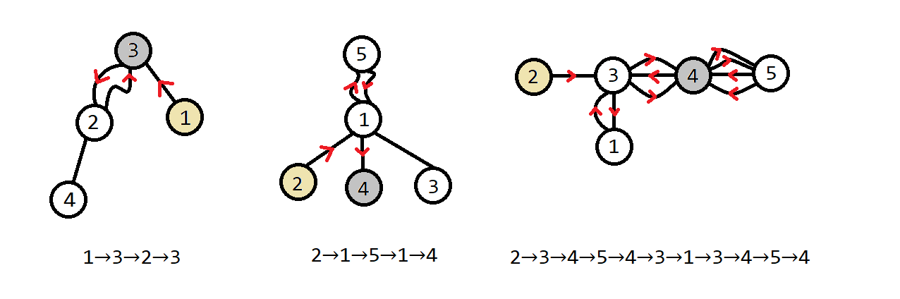

# 旅行计划

### 题目信息

时间限制:  `2s`

空间限制: `512M`

输入文件: `plan.in`

输出文件: `plan.out`

### 题目描述

YeahPotato 到自然公园去旅行！

自然公园的景点可以抽象成 $n$ 个节点，景点之间由固定的班车连接，班车可以双向地运送旅客，也就是说班车可以抽象成边。一共有 $n-1$ 对景点之间有班车，任意两个景点之间都可以互相到达。不过这 $n-1$ 对景点中有一部分对的两点间可能有 $>1$ 部班车（且它们的实地路线除端点外略有不同），也就是说，自然公园可以抽象成一棵有重边的树。

YeahPotato 考虑坐直升机先到达一个景点（起点），然后走过一些边到达另一个景点（终点，可以与起点重合）后再坐直升机离开。本着“风景在路上”的理念，YeahPotato 希望看到尽量多的风景，也就是走尽量多的边。他不希望重复经过一条边（同一条边的不同方向也不行），不过可以重复经过点。

给定自然公园的地图，求 YeahPotato 最多能经过几条边。

### 输入格式

本题有多组数据。第一行一个整数 $T$。

每组数据第一行一个整数 $n$。

接下来 $n-1$ 行，第 $i+1$ 行三个整数 $u_i,v_i,w_i$，分别表示一对有边的景点以及它们之间班车（重边）数。

保证输入构成一棵树。

### 输出格式

输出 $T$ 行，每行一个整数依次表示每组输入的答案。

### 样例

### 样例输入 1

```
3
4
3 1 1
2 4 1
2 3 2
5
1 2 1
1 3 1
1 4 1
1 5 2
5
2 3 1
3 1 2
3 4 3
4 5 4
```

### 样例输出 1

```
3
4
10
```

### 样例解释 1



### 样例输入 2

见下发文件夹中的 plan/plan2.in。

### 样例输出 2

见下发文件夹中的 plan/plan2.ans。

### 样例输入 3

见下发文件夹中的 plan/plan3.in。

### 样例输出 3

见下发文件夹中的 plan/plan3.ans。

### 样例输入 4

见下发文件夹中的 plan/plan4.in。

### 样例输出 4

见下发文件夹中的 plan/plan4.ans。

### 数据范围与提示

记 $\sum w$ 表示该测试点的**单组数据**内 $w$ 之和，$\sum n$ 表示该测试点内所有 $n$ 之和。

测试点 $1$ 满足 $n,\sum w\le 7,T\le 100$。

测试点 $2$ 满足 $n,\sum w\le 18,T\le 100$。

测试点 $3,4,5$ 满足 $u_i=i,v_i=i+1$ 即原树为一条链。

测试点 $3,7,8$ 满足 $n\le 3000,\sum n\le 15000$。

测试点 $4,7,9$ 满足 $w_i\ge 2$。

测试点 $6$ 满足 $n\le 300,\sum n\le 1500$。

测试点 $9$ 满足 $n\le 10^5,\sum n\le 3\times 10^5$。

测试点 $10$ 无额外限制。

对于 $100\%$ 的数据，$1\le T\le 10^4,1\le n\le 10^6,1\le \sum n\le 3\times 10^6,1\le w_i\le 10^9$。

### 提示

本题输入量较大，请使用较快的输入方式。
